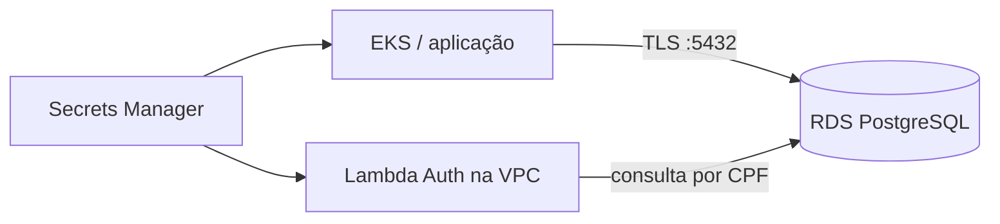

# Oficina Mecânica — Infraestrutura do Banco

Provisiona o PostgreSQL 16 gerenciado no Amazon RDS, sua regra de rede, credenciais no Secrets Manager e migrations SQL versionadas.

## Arquitetura e escolha



PostgreSQL foi escolhido pela consistência transacional necessária a orçamento, estoque e mudança de estado da OS, pelo suporte a constraints/índices e pela compatibilidade já existente com EF Core. O RDS fornece backups, criptografia e operação gerenciada.

O modelo relacional completo tem sua fonte nas migrations EF da aplicação. `migrations/V001__ef_initial_schema.sql` é o script PostgreSQL idempotente gerado a partir desse modelo e inclui o contrato compartilhado da autenticação: cliente identificado unicamente por documento e marcado como ativo/inativo.

## Uso

Pré-requisitos: Terraform 1.11+, AWS CLI e os outputs da infraestrutura Kubernetes. Copie `terraform.tfvars.example`, preencha `vpc_id`, `vpc_cidr_block` e `database_subnet_group_name`, então execute:

```bash
terraform init
terraform validate
terraform plan -var-file=terraform.tfvars
terraform apply -var-file=terraform.tfvars
```

A senha é gerada pelo Terraform e gravada no Secrets Manager; não é exposta como output. O pipeline valida Terraform, tfsec e SQLFluff. Merge em `main` realiza o deploy automático com aprovação do environment `production` e credenciais OIDC.

Para simplificar a entrega acadêmica, foi adotado um único ambiente (produção).
